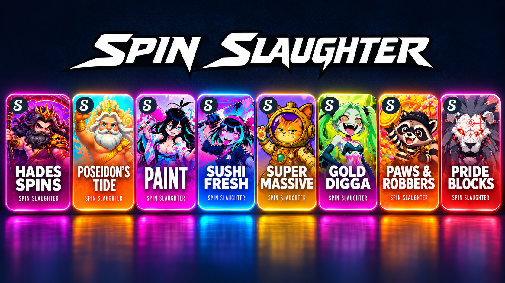

# Spin Slaughter

**Independent slot games on Stake. Public source to help the next creator get started.**

## Play the games

**[Stake.us](https://stake.us/casino/group/spin-slaughter) · [Stake.com](https://stake.com/casino/group/spin-slaughter) · [Talk to the creator on X](https://x.com/SpinSlaughter)**

| Game | Stake.us | Stake.com | Learn from the source |
|---|---|---|---|
| **Hades Spins** | [Play](https://stake.us/casino/games/spinslaughter-hades-spins) | [Play](https://stake.com/casino/games/spinslaughter-hades-spins) | [Code](https://github.com/chaosxcode/hades-spins) |
| **Poseidon's Tide** | [Play](https://stake.us/casino/games/spinslaughter-poseidons-tide) | [Play](https://stake.com/casino/games/spinslaughter-poseidons-tide) | [Code](https://github.com/chaosxcode/poseidons-tide) |
| **Paint** | [Play](https://stake.us/casino/games/spinslaughter-paint) | [Play](https://stake.com/casino/games/spinslaughter-paint) | Not published yet |
| **Sushi Fresh** | [Play](https://stake.us/casino/games/spinslaughter-sushi-fresh) | [Play](https://stake.com/casino/games/spinslaughter-sushi-fresh) | [Code](https://github.com/chaosxcode/sushi-slice) |
| **Super Massive** | [Play](https://stake.us/casino/games/spinslaughter-super-massive) | [Play](https://stake.com/casino/games/spinslaughter-super-massive) | [Code](https://github.com/chaosxcode/super-massive) |
| **Gold Digga** | [Play](https://stake.us/casino/games/spinslaughter-gold-digga) | [Play](https://stake.com/casino/games/spinslaughter-gold-digga) | [Code](https://github.com/chaosxcode/gold-digga) |
| **Paws & Robbers** | [Play](https://stake.us/casino/games/spinslaughter-paws-and-robbers) | [Play](https://stake.com/casino/games/spinslaughter-paws-and-robbers) | [Code](https://github.com/chaosxcode/paws-and-robbers) |
| **Pride Blocks** | [Play](https://stake.us/casino/games/spinslaughter-pride-blocks) | [Play](https://stake.com/casino/games/spinslaughter-pride-blocks) | [Code](https://github.com/chaosxcode/pride-blocks) |

*Sushi Fresh's source project is named Sushi Slice. Paint's game links are live; a public source repository is not listed here yet.*

## A starting point for new builders

I'm Mario, the creator of Spin Slaughter. Finding practical examples was one of the hardest parts of getting started, so I'm sharing my game frontends and math source for the people coming after me.

Read the projects, follow how the pieces fit together, and use what you learn to build something of your own. Each game repository documents its source layout and excluded build data.

**If you like a game, share it. If the code helps you, pass it on.** Reach me at [@SpinSlaughter](https://x.com/SpinSlaughter) if I can help with a project or a question.
